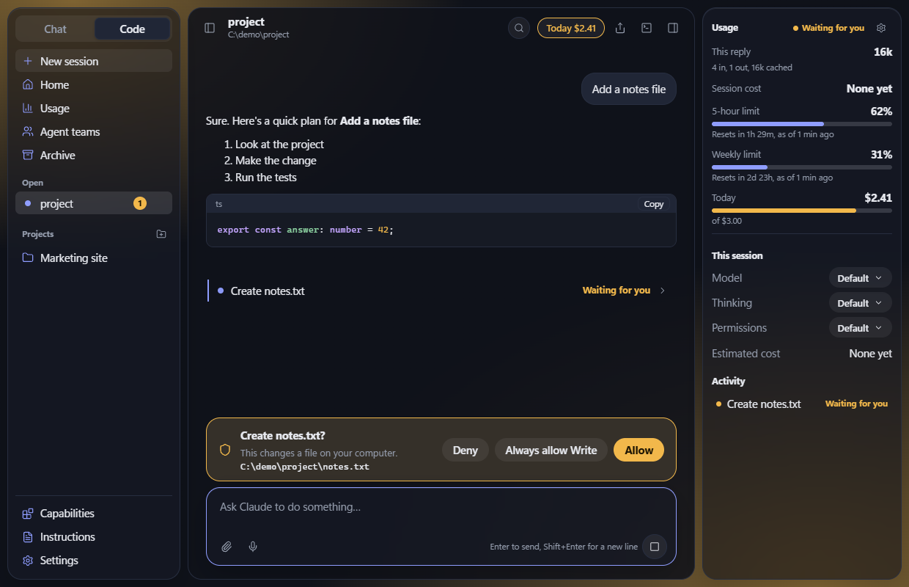
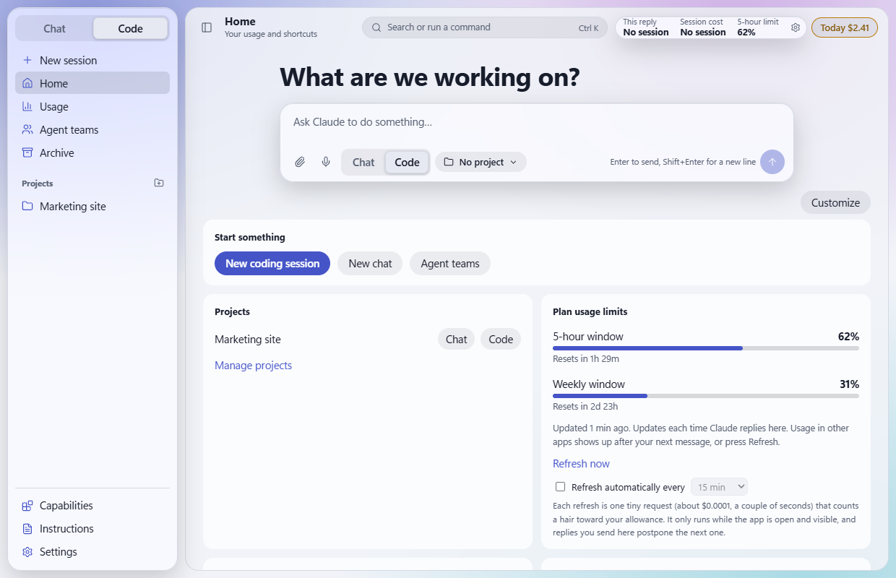
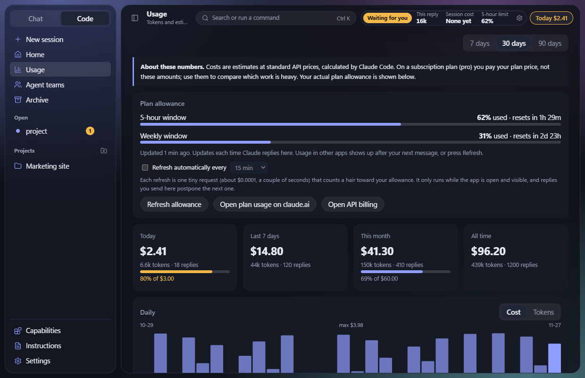
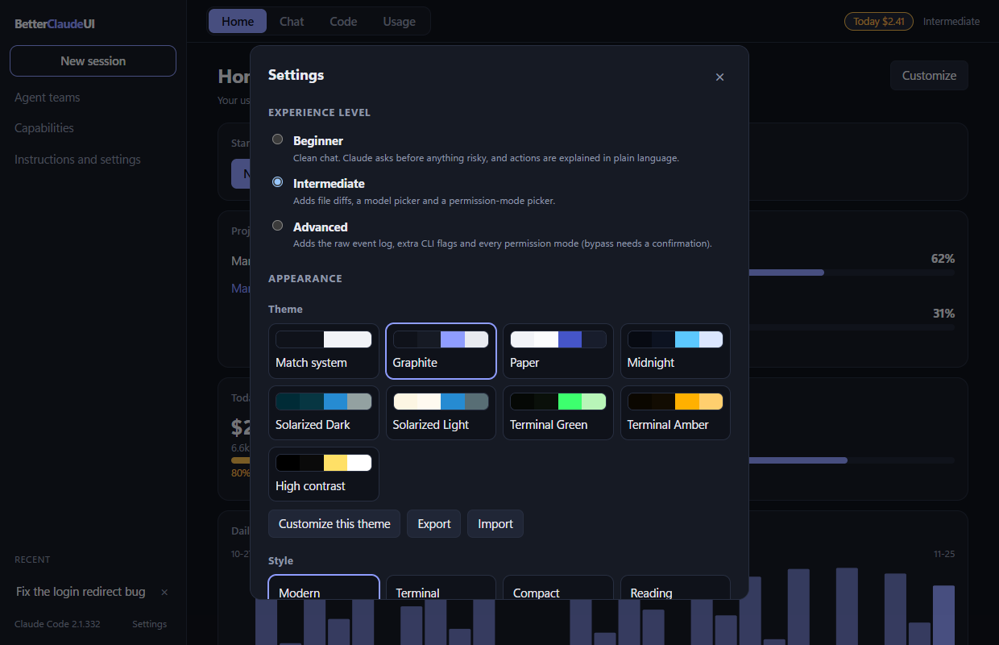

# BetterClaudeUI

A lightweight desktop UI for [Claude Code](https://claude.com/claude-code): the full power of the `claude` CLI, with a better interface than a terminal.

> **Unofficial.** BetterClaudeUI is an independent open-source project. It is not affiliated with or endorsed by Anthropic. It requires the official `claude` CLI, installed and logged in.

## Screenshots
| | |
|---|---|
|  |  |
|  |  |

_(Screenshots use demo data.)_

## Why
- **Full fidelity:** it drives the real CLI (streaming JSON mode), so hooks, skills, plugins, MCP, subagents and slash commands all work, and new CLI features arrive for free.
- **Light:** Tauri + Rust, not Electron.
- **Code and Chat modes** in one app.
- **Experience tiers:** Beginner, Intermediate, Advanced.
- **Usage and billing tracker:** tokens and estimated cost per day, model and project, plan allowance meters (5-hour and weekly), budgets and alerts.
- **Home dashboard** with a "What are we working on?" box and configurable widgets.
- **Usage widget:** tokens, estimated cost and plan limits while you work, in the right panel, floating or in the toolbar, with an optional **system tray / menu bar** version that tells you when Claude is waiting. It never sends a request on its own.
- **Projects** with standing instructions, **search** across conversations, **Ctrl+K command palette**, **web search in Chat**, **attachments**, slash commands, MCP/skills panels, CLAUDE.md and settings editors.
- **Export and import your data:** back up everything, move between computers, or bring conversations from Claude.ai, ChatGPT and other assistants into a searchable Archive you can continue from. See [docs/EXPORT_FORMAT.md](docs/EXPORT_FORMAT.md).
- **In-app updates:** signed updates only, checked quietly once a day (can be turned off), nothing installs without your click.
- **Setup wizard:** detects a missing or signed-out Claude Code and walks you through installing and signing in.
- **Themes and styles:** 8 themes, 4 styles (including a Terminal look), all editable, importable and exportable.
- **Multi-agent presets:** Coordinator + Workers, Deep Research, Code + Review.
- **Extensible:** features, presets and themes are modules/data files (see `docs/EXTENDING.md`).

## Download
Get the installer for your system from the [latest release](https://github.com/whyarealltheuserstaken/better-claude-ui/releases/latest). On Windows use the `-setup.exe` file. The installers are not code-signed: on Windows SmartScreen choose "More info", then "Run anyway"; on macOS right-click the app and choose "Open".

## Status
0.1.0 is the first release. Windows is the tested platform; macOS and Linux builds pass CI but have not been run on real hardware. Updates are signed and checked by the app; the installers themselves are not code-signed. See [`docs/RELEASING.md`](docs/RELEASING.md).

Roadmap and current state: See [`docs/PROGRESS.md`](docs/PROGRESS.md) for the roadmap and [`docs/HANDOFF.md`](docs/HANDOFF.md) for the current state.

Platforms: Windows 10/11 first; macOS (Intel + Apple Silicon, universal) and Linux to follow.

## Develop
Prerequisites: Node 20+, Rust stable, the `claude` CLI, and the [Tauri prerequisites](https://tauri.app/start/prerequisites/).

```
npm install
npm run tauri dev      # run the app
npm run check          # type-check UI
cargo test --manifest-path src-tauri/Cargo.toml
```

See [CONTRIBUTING.md](CONTRIBUTING.md) and [docs/ARCHITECTURE.md](docs/ARCHITECTURE.md).

## License
MIT
